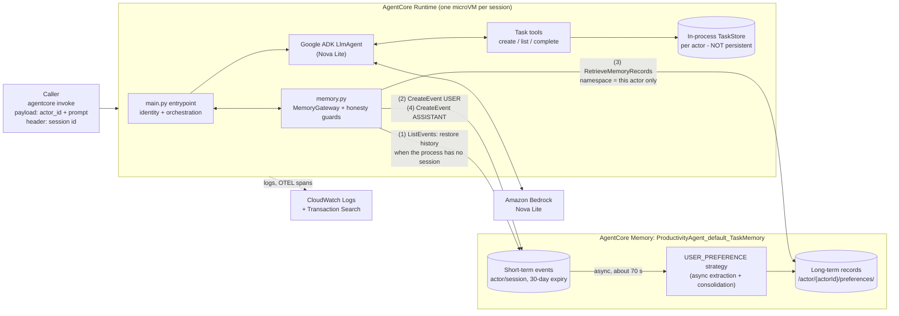

# Memory-Enabled Personal Productivity Assistant (V2): Google ADK + Amazon Bedrock AgentCore Memory

V2 extends the baseline task assistant ([docs/README-v1.md](docs/README-v1.md)) with **managed Amazon
Bedrock AgentCore Memory**:

- **Short-term memory:** each user and assistant message is stored as a conversational event per
  `actor_id` + `session_id`. A re-created agent process (new microVM, restart) rebuilds the
  conversation from those events.
- **Long-term memory:** a `USER_PREFERENCE` strategy extracts durable preferences, such as response
  format, from the events in the background. Later sessions retrieve and apply them.
- **Isolation:** every request carries an explicit `actor_id`. Preferences, events and tasks are scoped to it.
- **Honest failure handling:** memory failures are reported, never hidden, and guards in code stop the
  agent from claiming it saved or remembered something it did not.

The original `create_task`, `list_tasks` and `complete_task` tools and multi-tool orchestration are
unchanged. The V1 regression suite still passes 11/11.

| Item | Value |
|---|---|
| Agent framework | Google ADK 2.14.1 (`LlmAgent`, `Runner`, `InMemorySessionService`) |
| Model | Amazon Nova Lite `apac.amazon.nova-lite-v1:0` via ADK `LiteLlm` (Bedrock Converse) |
| Memory integration | `bedrock-agentcore` 1.26.0 / boto3 1.43.127 data-plane APIs (`CreateEvent`, `ListEvents`, `RetrieveMemoryRecords`, `ListMemoryRecords`) |
| Hosting | AgentCore Runtime, CodeZip, `PYTHON_3_13`, HTTP |
| Tooling | AgentCore CLI 1.0.3, AWS CDK 2.1148.1, AWS CLI 2.40.4, uv |
| Region | `ap-south-1` (Mumbai) |
| Tags | `Project: barclays` on the runtime, the memory and both IAM roles |

> **Deviation from the brief:** the brief names Strands Agents. As in V1, this build uses **Google ADK**,
> at the requester's direction. The brief allows "session manager or documented SDK integration"; this
> uses the documented AgentCore Memory data-plane APIs through the AgentCore SDK's boto3 client (see
> "Why not the SDK's `retrieve_memories`" below).

---

## 1. Architecture



### Per-request flow (`main.py`)

| Step | What happens | API | Path |
|---|---|---|---|
| 0 | Validate `actor_id` (required, no default identity). Session id = runtime session header | n/a | n/a |
| 1 | If this process has **no ADK session** for (actor, session), load the last turns from Memory and replay them into a new ADK session | `ListEvents` | short-term **read** |
| 2 | Save the user message as an event. Long-term extraction reads these events | `CreateEvent` (role `USER`) | event **write** |
| 3 | Semantic search over **this actor's** preference namespace with the prompt as query (top 5, newest first) | `RetrieveMemoryRecords` | long-term **read** |
| 4 | Run the ADK agent. The memory block (records plus status: OK, EMPTY or UNAVAILABLE, and whether the message was saved) goes into the dynamic instruction | Bedrock Converse | n/a |
| 5 | Apply code guards (below), then save the assistant reply as an event | `CreateEvent` (role `ASSISTANT`) | event **write** |

The response includes a `memory` object with every memory operation's result, event IDs, the retrieved
records and the namespace, so each turn shows what memory did.

### Code-level guards

Nova Lite does not always follow instructions, so these behaviours are enforced in code and covered by
unit tests:

| Guard | Problem it prevents | Where |
|---|---|---|
| Write-honesty | Saving the message failed, but the reply says "I've noted your preference…" (MEM-09). Claim sentences are removed and an explicit "couldn't save" notice is added | `memory.enforce_write_honesty` |
| Retrieval-honesty | Retrieval failed, but the reply says "you have no stored preferences" (false: it could not check). Preference sentences are removed and an "unavailable" notice is added | `memory.enforce_retrieval_honesty` |
| Grounding | The reply shows task IDs that no tool returned this turn, i.e. task status recalled from memory text (MEM-10). The turn is retried once, with an instruction to call `list_tasks` | `agent.ungrounded_task_ids` + `run_turn` |
| Empty reply | The model ends a turn with only internal `<thinking>` text. It is retried once for a visible reply | `agent.run_turn` |
| Output hygiene | Inline `<thinking>` or `<reply>` tags, or echoed internal memory-context lines, reach the user | `agent.split_inline_thinking` |
| Due-date grounding (V1) | The model invents a due date the user never gave | `tools.create_task` |

### Responsibilities

| Layer | Owns |
|---|---|
| **Google ADK** | Agent loop (prompt → model → tool calls → answer), in-process session (`InMemorySessionService`), tool schemas, tool-error callback, OTEL spans |
| **This app** (`main.py`, `memory.py`) | Identity mapping (`actor_id`, session id), when to read and write Memory, replaying history into ADK, putting retrieved preferences into the prompt, honesty and grounding guards |
| **AgentCore Runtime** | Hosting, one microVM per session, SigV4/IAM inbound auth, execution-role credentials, logs and traces |
| **AgentCore Memory** | Durable event storage (30-day expiry), asynchronous preference extraction and consolidation, semantic retrieval by namespace |

---

## 2. Memory configuration (MEM-01)

Provisioned as code in `agentcore/agentcore.json` (`agentcore add memory …`) and deployed by CDK:

```json
"memories": [{
  "name": "TaskMemory",
  "eventExpiryDuration": 30,
  "strategies": [{
    "type": "USER_PREFERENCE",
    "name": "user_preferences",
    "namespaceTemplates": ["/actor/{actorId}/preferences/"]
  }]
}]
```

Reproduce with:

```bash
agentcore add memory --name TaskMemory --event-expiry-duration 30 \
  --strategies '[{"type":"USER_PREFERENCE","name":"user_preferences","description":"Durable user preferences such as response format, working hours and prioritization style","namespaceTemplates":["/actor/{actorId}/preferences/"]}]'
agentcore deploy --yes --region ap-south-1
```

| Setting | Value |
|---|---|
| Memory ID | `ProductivityAgent_default_TaskMemory-LqBSxx75HT` (status `ACTIVE`) |
| Strategy | `user_preferences-opRIaKFLR5`, type `USER_PREFERENCE` |
| Long-term namespace | `/actor/{actorId}/preferences/`, actor-scoped. The trailing slash stops `USER-A` prefix-matching `USER-AB` |
| Event retention | 30 days (`eventExpiryDuration`) for short-term events. Long-term records persist until deleted |
| Encryption | AWS-owned key (default). Production: a customer-managed KMS key (`--encryption-key-arn`) |
| Runtime discovery | The CDK construct injects `MEMORY_TASKMEMORY_ID` and `MEMORY_TASKMEMORY_ARN` into the runtime environment (nothing hardcoded) |

**Why only `USER_PREFERENCE`:** the brief requires it. `SEMANTIC` was deliberately left out: it would
extract facts such as "user created a task to review the budget", which could later be recalled as if
they were current task status. That is exactly the confusion MEM-10 forbids. Task state comes only from
the task tools.

### Identity design

| Identifier | Source | Scopes |
|---|---|---|
| `actor_id` | Request payload, **required** and validated (`[A-Za-z0-9][A-Za-z0-9_\-.@]{0,99}`). There is no default actor | Long-term namespace, events, task store, ADK session `user_id` |
| `session_id` | AgentCore runtime session header (`agentcore invoke --session-id`, 33 characters or more) | Events, ADK session, runtime microVM |

> **Trust boundary:** in this POC the caller asserts `actor_id`. Isolation is only as strong as that
> mapping. In production, derive `actor_id` from a verified identity (for example the JWT `sub` claim via
> a runtime JWT authorizer) and never accept it from the request body.

### IAM (least privilege, generated by the AgentCore CDK construct)

Runtime execution role, Memory statements (from the deployed CloudFormation template):

| Actions | Resource | Condition |
|---|---|---|
| `RetrieveMemoryRecords`, `ListMemoryRecords` | this memory ARN | `bedrock-agentcore:namespace` / `namespacePath` StringLike `/actor/*/preferences/` |
| `CreateEvent`, `ListEvents`, `GetEvent`, `DeleteEvent`, `ListSessions`, `ListActors`, `GetMemory`, `GetMemoryRecord`, `DeleteMemoryRecord` | this memory ARN | none (these actions do not support namespace conditions) |

Note that the role can read **any** actor's records under `/actor/*/preferences/`. Per-user isolation is
enforced by the app's identity mapping, not by IAM. For hard per-user isolation at the IAM level, give
each caller scoped credentials with the actor ID in the namespace condition.

The memory also has its own service role (`ApplicationMemoryTaskMemoryServiceRole…`), created by CDK.

The developer IAM user (`mojahid`) was verified to have `CreateEvent`, `ListEvents`,
`RetrieveMemoryRecords`, `ListMemoryRecords`, `ListActors`, `DeleteEvent` and `StopRuntimeSession`, which
local development and the demo need.

---

## 3. Project layout (changes from V1)

```
ProductivityAgent/
├── agentcore/agentcore.json      # + memories[TaskMemory] (USER_PREFERENCE, 30-day events)
├── agentcore/.env.local          # + MEMORY_TASKMEMORY_ID for local dev (gitignored)
├── app/agent/
│   ├── main.py                   # V2: actor_id, history restore, event writes, retrieval, guards
│   ├── memory.py                 # NEW: MemoryGateway (failure-aware), honesty guards, actor validation
│   ├── agent.py                  # V2: memory rules, memory context in instruction, history replay,
│   │                             #     grounding / empty-reply retries, output hygiene
│   ├── tools.py                  # V2: task store keyed by actor (still in-process only)
│   ├── task_store.py             # unchanged
│   └── tests/                    # 34 unit tests (+ test_memory.py, test_agent_memory.py)
├── scripts/run_demo_v2.py        # NEW: V2 memory scenarios via agentcore CLI, polls extraction
├── scripts/run_demo.py           # V1 scenarios, now a regression suite (sends an actor_id)
├── evidence/v2/                  # V2 transcripts, memory inspections, logs and traces
├── evidence/v1/                  # V1 evidence (archived)
└── docs/README-v1.md             # V1 README (archived)
```

---

## 4. Prerequisites and setup

The V1 prerequisites ([docs/README-v1.md §3](docs/README-v1.md)) still apply: AWS CLI v2, Node.js 20+,
`npm install -g @aws/agentcore aws-cdk`, uv, CDK bootstrap with `--tags Project=barclays`, and the
`mojahid_agent` profile.

V2 additions:
1. Add the memory to the project (command in §2), or use the existing `agentcore.json`.
2. Run `agentcore deploy --yes --region ap-south-1`. This creates the Memory resource and binds it to
   the runtime.
3. For local development, add the memory ID to `agentcore/.env.local`:
   ```
   MEMORY_TASKMEMORY_ID=ProductivityAgent_default_TaskMemory-LqBSxx75HT
   ```

---

## 5. Run and test locally

```powershell
cd ProductivityAgent
cd app/agent; uv run pytest -q; cd ../..          # 34 passed (no AWS, no LLM)
$env:AWS_PROFILE = "mojahid_agent"
agentcore dev --agent agent --mode headless --region ap-south-1
```

In a second terminal (Git Bash, or use the script):

```bash
agentcore invoke --local --runtime agent --session-id my-session-a-00000000000000000000001 \
  --payload '{"actor_id":"USER-A","prompt":"Remember that I prefer short bullet-point task summaries."}'

python scripts/run_demo_v2.py --mode local     # all V2 memory scenarios, about 6 min (waits for extraction)
python scripts/run_demo.py --mode local        # V1 regression (tools and orchestration)
```

Restart `agentcore dev` after code changes; the Windows reloader is unreliable.

## 6. Deploy (CodeZip) and invoke remotely (MEM-11)

```bash
agentcore deploy --yes --region ap-south-1
agentcore status --region ap-south-1
python scripts/run_demo_v2.py --mode remote    # same scenarios on AgentCore Runtime
python scripts/run_demo.py --mode remote       # V1 regression in the cloud
```

Request payload:

```json
{
  "actor_id": "USER-A",
  "prompt": "Show my tasks in my preferred format.",
  "simulate_failure": ["memory_retrieve"],
  "simulate_restart": true
}
```

- `actor_id` is required.
- `simulate_failure` is optional. Memory values are `memory_retrieve` and `memory_write`, and apply to
  that request only. Tool values (`list_tasks`, `create_task`, `complete_task`) stay on for the session
  until `[]` is sent.
- `simulate_restart` is optional and for local use only: it drops this process's state for the
  actor and session.

To re-create the agent process in the cloud (a new microVM for the same session):

```bash
aws bedrock-agentcore stop-runtime-session --region ap-south-1 \
  --agent-runtime-arn arn:aws:bedrock-agentcore:ap-south-1:590183725128:runtime/ProductivityAgent_default_agent-dxt08oE1hB \
  --runtime-session-id <session-id>
```

---

## 7. Demo scenarios and acceptance criteria

Each run uses fresh actors (`USER-A-<run>`, `USER-B-<run>`), so earlier runs cannot affect the result.
Long-term extraction is **polled** with `agentcore memory record list`, never assumed. Every turn is also
checked for task IDs that no tool returned (MEM-10) and for leaked internal tags or context.

| # | Scenario (actor / session) | Input | Evidence of success | AC |
|---|---|---|---|---|
| 1a | USER-A / A | "Create a task for architecture review." | No task created; agent asks for the due date (no invented date) | MEM-10 |
| 1b | USER-A / A | "What task did I just ask you to create?" | Answers about "architecture review" from session context | MEM-03 |
| 1c | USER-A / A, **process re-created** (`StopRuntimeSession` in the cloud, `simulate_restart` locally) | "Remind me: what task did I ask you to create earlier…?" | `history_source=ok`, `history_restored=4` from `ListEvents`; recalls the task | MEM-03, MEM-04 |
| 2 | USER-A / A | "Remember that I prefer short bullet-point task summaries." | `CreateEvent` id returned; preference acknowledged; record extracted after about 67 to 72 s | MEM-04, MEM-05 |
| 3 | USER-A / **new session B** | create 2 tasks, then "Show my tasks in my preferred format." | `retrieval=ok`; `list_tasks` called; bullet output | MEM-06, MEM-10 |
| 4 | **USER-B** / C | "What output format do I prefer?" | `retrieval=empty`; USER-B namespace has 0 records; reply reveals nothing about USER-A | MEM-07 |
| 5 | USER-A / B | "From now on, use a table rather than bullet points." | Event saved; the strategy **consolidated** the record into "prefers tables … superseding the earlier bullet-point preference" (about 69 to 85 s) | MEM-08 |
| 6 | USER-A / **new session D** | create task, then "List my pending tasks using my preferred format." | `list_tasks` called; table output (latest preference) | MEM-08, MEM-10 |
| 7a | USER-A / E, `simulate_failure: memory_retrieve` | "What output format do I prefer?" | `retrieval=unavailable`; reply says it cannot access stored preferences; no preference claimed (guard) | MEM-09 |
| 7b | USER-A / E, `simulate_failure: memory_write` | "Remember that I usually plan my work in the morning." | `user_event=unavailable`; reply says it could not save; no "noted" claim (guard) | MEM-09 |
| 8 | all of the above on AgentCore Runtime | n/a | `evidence/v2/demo-remote.md` | MEM-11 |

**Results (final code, runtime version 4, 2026-11-22):**

| Suite | Local (`agentcore dev`) | AgentCore Runtime |
|---|---|---|
| V2 memory scenarios (`run_demo_v2.py`) | **13/13 PASS** | **13/13 PASS** |
| V1 regression: task tools and orchestration (`run_demo.py`) | **11/11 PASS** | **11/11 PASS** |
| Unit tests (`pytest`) | 34 passed | n/a |

Measured long-term extraction latency: **67 to 72 s** for a new preference and **68 to 85 s** for an
update, across 4 runs. In the cloud run, `StopRuntimeSession` returned HTTP 200, and the next request with
the same session ID ran in a **new microVM** that restored 4 messages from AgentCore Memory events.

### Evidence index (`evidence/v2/`)

| File | Contents |
|---|---|
| `demo-local.md` / `demo-remote.md` (+ `.json`) | Each turn: request, tool calls, memory status (history, event ID, retrieval and records), reply, check result |
| `memory-inspection-local.json` / `-remote.json` | Raw `agentcore memory record list` for USER-A and USER-B, plus `memory event list` for session A (USER-A) and session C (USER-B) |
| `regression-v1-local.md` / `-remote.md` | V1 scenarios against the V2 agent |
| `logs-memory-ops-remote.txt` | Runtime logs filtered to `memory.*` operations (create_event, list_events, retrieve, with IDs) |
| `logs-errors-remote.txt` | ERROR logs: the injected `RetrieveMemoryRecords` / `CreateEvent` failures |
| `logs-guards-remote.txt` | WARNING logs: honesty guards applied (write / read) |
| `traces-list-remote.txt` | Trace IDs per invocation and session (`agentcore traces runtime get <id>` for detail) |

The remote log files cover the last two cloud runs (actors `USER-A-R1200` and `USER-A-R1209`). The
remote demo transcript is from the final run (`R1209`).

---

## 8. Memory inspection and observability (MEM-04, MEM-05, MEM-12)

```bash
M=ProductivityAgent_default_TaskMemory-LqBSxx75HT
agentcore memory get --id $M                                                       # resource + strategies
agentcore memory session list --id $M --actor-id USER-A-<run>                      # sessions of an actor
agentcore memory event list   --id $M --actor-id USER-A-<run> --session-id <sid> --include-payloads
agentcore memory record list  --id $M --namespace /actor/USER-A-<run>/preferences/  # long-term records

agentcore logs runtime --name agent --since 1h --query '"memory."'   # every memory operation
agentcore logs runtime --name agent --since 1h --level error        # memory / tool failures
agentcore traces runtime list --name agent --since 1h
```

The demo writes `evidence/v2/memory-inspection-<mode>.json`, a raw dump of `memory record list` for
both actors and `memory event list` for the key sessions.

What gets logged (logger `productivity_agent.memory`):

| Log line | Meaning |
|---|---|
| `memory.create_event ok actor=… session=… role=USER event=…` | Event written |
| `memory.list_events ok … messages=N` | History read (process had no local session) |
| `memory.retrieve ok actor=… namespace=/actor/…/preferences/ records=N ids=[…]` | Long-term retrieval, with record IDs |
| `memory.retrieve FAILED …` / `memory.create_event FAILED …` (ERROR) | Memory failure, with the exception |
| `memory honesty guard applied (write=… read=…)` (WARNING) | A guard changed the reply |
| `reply mentions tasks … not returned by a tool this turn; grounding retry` (WARNING) | Grounding guard fired |

A sample record as stored by the `USER_PREFERENCE` strategy (`content.text` is JSON):

```json
{"context":"Summarizing tasks or reviewing task lists",
 "preference":"Prefers short bullet-point task summaries",
 "categories":["task summaries","formatting","communication style"]}
```

After the update in scenario 5, the **same namespace holds one consolidated record**, for example:
*"Prefers task lists shown as a table rather than bullet points (as of 2026-11-22); previously preferred
short bullet-point task summaries"*.

---

## 9. Engineering notes

**Short-term vs long-term memory**

| | Short-term (events) | Long-term (records) |
|---|---|---|
| What is stored | Raw `USER` / `ASSISTANT` messages | Extracted preference JSON |
| Written by | The app (`CreateEvent`), synchronously, every turn | The `USER_PREFERENCE` strategy, asynchronously |
| Available | Immediately | About 65 to 85 s later in our runs (eventually consistent) |
| Read by | `ListEvents` (exact actor and session) | `RetrieveMemoryRecords` (semantic, per namespace) |
| Scope | One actor's session | One actor, all sessions |
| Lifetime | 30 days (`eventExpiryDuration`) | Until deleted (`DeleteMemoryRecord`) |

**Asynchronous extraction:** a preference stated in session A is not instantly available to session B.
Within session A it still works, because the history is in context. The demo polls; the agent says
"available in future sessions once processing completes" and never claims instant recall.

**Retrieval limits:** semantic top 5 per turn, using the prompt as the query. A preference that isn't
semantically close to the request may not be retrieved; that is acceptable for style preferences, and
`list_preferences` exists for full inspection. Records are rendered newest first, and the instruction
says the most recent preference wins.

**Conflicts and updates:** the strategy's consolidation merged "bullets" and "tables" into one record
that states which supersedes which. If two conflicting records ever co-exist, the prompt lists them
newest first and rule M4 tells the model to follow the latest and say so. An explicit instruction in the
current message always overrides stored preferences (rule M3).

**Memory vs task persistence:** AgentCore Memory is **not** a task database. The task store is still in
process (now keyed by actor). Locally, tasks survive across a user's sessions while `agentcore dev` keeps
running. On AgentCore Runtime **each session is a separate microVM, so tasks do not carry over between
sessions or restarts**: in the remote run, session D's first task is again `TASK-001`. Reliable
cross-session task operations need a transactional store such as DynamoDB, with conditional writes for
status changes, idempotency and queryable state. Memory records are eventually consistent, LLM-extracted
summaries, so they are unsuitable as a system of record.

**Why not the SDK's `retrieve_memories`:** in `bedrock-agentcore` 1.26.0,
`MemoryClient.retrieve_memories` catches every `ClientError` (including AccessDenied) and returns `[]`,
which makes "memory down" look like "no preferences". `memory.py` calls the boto3 data plane directly so
the two stay distinct (`unavailable` vs `empty`).

**Failure modes covered:** memory not configured (`disabled`), read failure (`unavailable`, guard), write
failure (`unavailable`, guard), empty memory (`empty`), history unavailable on restore (starts without
history, logged), model returns an empty reply (retry), model invents task data (grounding retry).

**Cost drivers:** AgentCore Memory charges for short-term event storage, long-term records stored,
long-term extraction or processing, and retrieval calls. Runtime charges for active session compute.
Bedrock charges Nova Lite tokens; each turn's prompt now also carries the memory block, so it is slightly
larger. Each turn makes 2 `CreateEvent`, 1 `RetrieveMemoryRecords` and, on a cold process, 1
`ListEvents`. Check the [AgentCore pricing page](https://aws.amazon.com/bedrock/agentcore/pricing/) for
current rates; they were not verified for this write-up.

**Privacy and security:**
- Events hold raw conversation text for 30 days; records are kept until deleted.
- AWS documents that the built-in strategies ignore PII when creating long-term records, but raw events
  still contain whatever the user typed, and runtime logs record prompts. Keep the 14-day log retention
  and use KMS for logs and Memory in production.
- Honour deletion requests with `DeleteEvent` / `DeleteMemoryRecord` per actor.
- Never trust a caller-supplied `actor_id` in production.

**Known model limitations (Nova Lite):**
- Some replies are clumsy. For example, it may repeat its due-date question when asked "what task did I
  ask you to create?"
- It sometimes needs the grounding or empty-reply retry.

The guards make the outcomes safe, not elegant. `apac.amazon.nova-pro-v1:0` follows instructions better;
switching needs only the `MODEL_ID` change.

---

## 10. AWS resources and cleanup (MEM-13)

| Resource | ID | Created by |
|---|---|---|
| AgentCore Runtime + `DEFAULT` endpoint | `ProductivityAgent_default_agent-dxt08oE1hB` | stack `AgentCore-ProductivityAgent-default` |
| Runtime execution role + policy | `AgentCore-ProductivityAge-ApplicationRuntimeAgentRu-*` | same stack |
| **AgentCore Memory** | `ProductivityAgent_default_TaskMemory-LqBSxx75HT` | same stack |
| Memory service role | `AgentCore-ProductivityAge-ApplicationMemoryTaskMemo-*` | same stack |
| Runtime log group | `/aws/bedrock-agentcore/runtimes/ProductivityAgent_default_agent-dxt08oE1hB-DEFAULT` | AgentCore service |
| CDK bootstrap (`CDKToolkit`), Transaction Search | see [docs/README-v1.md §9](docs/README-v1.md) | shared |

Inventory:

```bash
agentcore status --region ap-south-1
aws cloudformation describe-stack-resources --stack-name AgentCore-ProductivityAgent-default --region ap-south-1
agentcore memory list --region ap-south-1
```

Removal:

```bash
agentcore remove all --yes
agentcore deploy --yes --region ap-south-1     # deletes the stack: runtime, memory (events + records), roles
aws cloudformation describe-stacks --stack-name AgentCore-ProductivityAgent-default --region ap-south-1   # expect "does not exist"
agentcore memory list --region ap-south-1       # expect no ProductivityAgent memory
MSYS_NO_PATHCONV=1 aws logs delete-log-group --region ap-south-1 \
  --log-group-name /aws/bedrock-agentcore/runtimes/ProductivityAgent_default_agent-dxt08oE1hB-DEFAULT
```

Then the optional CDK bootstrap and Transaction Search steps from the V1 README.

**Retention implications:**
- Deleting the Memory resource deletes all its events and long-term records; that cannot be undone.
- While it exists, events expire after 30 days but **long-term records do not**. Remove individual
  users with `DeleteMemoryRecord` / `DeleteEvent`.
- Runtime logs keep prompts for their retention period, even after the memory is deleted.
