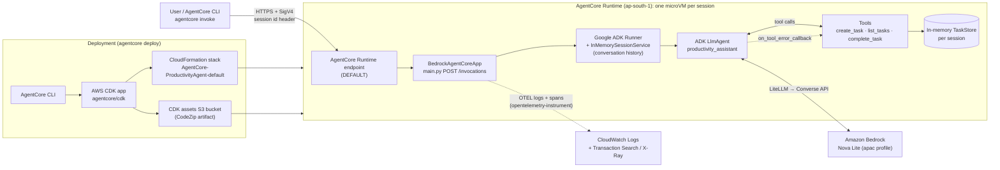

# Personal Productivity Assistant: Google ADK on Amazon Bedrock AgentCore

This is an AI agent that manages a user's tasks through natural language. It is
built with **Google Agent Development Kit (ADK) 2.14**, uses **Amazon Nova Lite**
on Amazon Bedrock as its model, and is deployed to **Amazon Bedrock AgentCore
Runtime** as a **CodeZip** artifact with the **AgentCore CLI**.

> "Create a task to complete the architecture review by Friday and show me all my pending tasks."

The model reads the request, picks the tools it needs (`create_task`,
`list_tasks`, `complete_task`), runs them in order, and combines the results
into one answer. No operation sequence is hardcoded.

| Item | Value |
|---|---|
| Agent framework | Google ADK `google-adk` 2.14.1 (`LlmAgent` + `Runner`) |
| Model | Amazon Nova Lite, APAC inference profile `apac.amazon.nova-lite-v1:0`, via ADK's `LiteLlm` adapter (Bedrock Converse API) |
| Hosting | Amazon Bedrock AgentCore Runtime, CodeZip, `PYTHON_3_13`, HTTP protocol |
| Tooling | AgentCore CLI 1.0.3 (`@aws/agentcore`), AWS CDK 2.1148, AWS CLI 2.40, uv |
| Region | `ap-south-1` (Mumbai) |
| Tagging | `Project: barclays` on every deployed resource (project-level tag in `agentcore/agentcore.json`) |

> **Deviation from the brief:** the assignment names Strands Agents. At the
> requester's direction this build uses **Google ADK** instead. Everything else
> follows the brief: AgentCore CLI, CodeZip, AgentCore Runtime, observability.
> AgentCore CLI 1.0.3 has no Google ADK template, so the project was scaffolded
> with `agentcore create --template agent-python-minimal` and ADK was added on
> top of it.

---

## 1. Architecture



### Request lifecycle (what happens on `agentcore invoke`)

1. The CLI signs a `InvokeAgentRuntime` request with SigV4 and sends the
   payload `{"prompt": ...}` with a runtime session id (33 characters or more).
2. AgentCore Runtime sends the session to a dedicated microVM, starting one
   on first use (cold start). Later requests with the same session id reach
   the **same microVM**. That is why in-memory state (conversation history
   and tasks) survives between turns of one session.
3. `BedrockAgentCoreApp` receives `POST /invocations` and calls the
   `@app.entrypoint` handler with `context.session_id`.
4. The handler maps the AgentCore session id to an ADK session and runs
   `Runner.run_async`. ADK builds the prompt from the dynamic instruction
   (today's date plus a 7-day calendar), the conversation history and the tool
   schemas, then calls Nova Lite through LiteLLM and the Bedrock Converse API.
5. Nova returns tool calls. ADK runs them, sends the results back, and loops
   until the model produces a final text answer.
6. The handler returns `{response, tool_calls, reasoning, session_id, model}`.
   Logs and OTEL spans (`invoke_agent`, `generate_content`, `execute_tool`)
   flow to CloudWatch.

### Responsibilities: framework vs. platform

| Google ADK (agent framework) | AgentCore Runtime (platform) |
|---|---|
| Agent loop: prompt assembly, model calls, tool-call parsing and execution, retries on tool errors | Serverless hosting and scaling; session-to-microVM isolation |
| Tool schemas generated from Python signatures and docstrings | Endpoint, SigV4/IAM (or JWT) inbound auth |
| Conversation state (`InMemorySessionService`) | Execution role: temporary AWS credentials for Bedrock calls |
| Callbacks (`on_tool_error_callback`), OTEL spans for agent, LLM and tool | Log and trace delivery to CloudWatch; versioning and endpoints |

---

## 2. Project layout

```
ProductivityAgent/
├── agentcore/
│   ├── agentcore.json        # project config: runtime (CodeZip, PYTHON_3_13), env vars, tags
│   ├── aws-targets.json      # deployment target (account + ap-south-1), created on first deploy
│   ├── .env.local            # local-only env for `agentcore dev` (gitignored)
│   └── cdk/                  # CDK app generated by the CLI (AgentCoreApplication construct)
├── app/agent/                # the CodeZip payload
│   ├── main.py               # AgentCore entrypoint (BedrockAgentCoreApp)
│   ├── agent.py              # ADK LlmAgent, Nova via LiteLlm, dynamic instruction, runner
│   ├── tools.py              # create_task / list_tasks / complete_task, error handling, failure injection
│   ├── task_store.py         # in-memory TaskStore, validation, typed errors
│   ├── tests/                # pytest unit tests (no LLM, no AWS)
│   └── pyproject.toml        # deps: google-adk, litellm, bedrock-agentcore, aws-opentelemetry-distro
├── scripts/run_demo.py       # runs every demo scenario through `agentcore invoke` (local or remote)
└── evidence/                 # demo transcripts, logs and traces captured from real runs
```

### Design notes

- **Tools return structured results** (`{"status": "success"|"error", ...}`).
  Expected errors (validation, unknown id) are caught in the tool and
  returned as data, so the model can explain them.
- **Unexpected tool exceptions** are converted by ADK's `on_tool_error_callback`
  (`tools.handle_tool_error`) into `{"status":"error","error_type":"tool_failure"}`.
  The agent loop never crashes, and the model is told explicitly that "The
  operation was NOT performed".
- **Due-date grounding guard (in code, not just the prompt):** `create_task`
  needs `user_due_date_phrase`, the date words exactly as the user wrote them.
  The tool checks that those words appear in the user's messages in this
  session. Without it, Nova Lite sometimes invented a date ("tomorrow") for
  "Create a task to call the vendor".
- **Relative dates:** each turn's instruction includes today's date and the
  next 7 days with weekday names. The LLM turns "Friday" into `YYYY-MM-DD`,
  and `TaskStore` validates it deterministically: ISO format, real calendar
  date, not in the past.
- **State scope:** tasks and history are kept per session id. On AgentCore
  Runtime that matches the per-session microVM. Data disappears when the
  session ends, which the brief explicitly allows.
- **Failure injection (demo scenario 6):** send `"simulate_failure": ["list_tasks"]`
  (any of the three tools) in the payload. The flag lasts for the session until
  `"simulate_failure": []` is sent.

---

## 3. Prerequisites

| Tool | Version used | Install |
|---|---|---|
| AWS CLI v2 | 2.40.4 | https://docs.aws.amazon.com/cli/latest/userguide/getting-started-install.html |
| Node.js | 20+ (26.13 used) | `winget install OpenJS.NodeJS.LTS` |
| AgentCore CLI | 1.0.3 | `npm install -g @aws/agentcore` |
| AWS CDK CLI | 2.1148 | `npm install -g aws-cdk` |
| uv | 0.13+ | `irm https://astral.sh/uv/install.ps1 \| iex` |
| Python | 3.13 (uv downloads it automatically) | n/a |

**AWS account setup (AC-01)**

1. Credentials: this build uses an IAM-user access-key profile:
   ```powershell
   aws configure --profile mojahid_agent       # access key, secret, region ap-south-1
   aws sts get-caller-identity --profile mojahid_agent
   ```
2. Model access: confirm that Nova Lite is invocable in the region:
   ```bash
   aws bedrock-runtime converse --model-id apac.amazon.nova-lite-v1:0 \
     --messages '[{"role":"user","content":[{"text":"Reply with OK"}]}]' \
     --inference-config '{"maxTokens":10}' --profile mojahid_agent --region ap-south-1
   ```
3. CDK bootstrap: run once per account and region, **with the project tag**,
   because the account's IAM policy requires `Project: barclays` on created
   resources:
   ```powershell
   cdk bootstrap aws://<ACCOUNT_ID>/ap-south-1 --profile mojahid_agent --tags Project=barclays
   ```

---

## 4. Local development and testing (AC-10)

```powershell
cd ProductivityAgent
$env:AWS_PROFILE = "mojahid_agent"

# Unit tests: task store, validation, tools, error handler (no LLM calls)
cd app/agent; uv run pytest -q; cd ../..          # 19 passed

# Start the local AgentCore dev server (uvicorn on :8080, local OTEL collector)
agentcore dev --agent agent --mode headless --region ap-south-1
```

`agentcore/.env.local` provides `AWS_PROFILE`, `AWS_REGION`, `MODEL_ID` and
`AGENT_TIMEZONE` to the local process.

In a second terminal:

```bash
# single call (Git Bash / macOS / Linux; see the Windows note below)
agentcore invoke --local --runtime agent --session-id my-local-session-0000000000000001 \
  --payload '{"prompt":"Create a task to complete the architecture review by Friday."}'

# all demo scenarios in one session, with automatic checks; writes evidence/demo-local.md
python scripts/run_demo.py --mode local
```

> **Windows note:** Windows PowerShell 5.1 strips the inner quotes from JSON
> passed to native commands, so `--payload '{"prompt":...}'` reaches the agent
> as invalid JSON. Use Git Bash, PowerShell 7, or `scripts/run_demo.py`, which
> calls the CLI's Node entrypoint directly.
>
> If `agentcore dev` stops when its terminal's stdin closes (for example, run
> from a script), keep stdin open: `tail -f /dev/null | agentcore dev ...`.
> The hot reloader sometimes misses changes on Windows; restart `agentcore dev`
> after you edit code.

---

## 5. Deploy to AgentCore Runtime (AC-11)

```powershell
agentcore deploy --region ap-south-1 --yes
agentcore status --region ap-south-1
```

`agentcore deploy`:

1. creates the `default` target in `agentcore/aws-targets.json` (account + region)
2. builds the **CodeZip** artifact: installs `app/agent` dependencies for
   linux/arm64 Python 3.13 and zips them with the code
3. synthesizes the CDK app and publishes the zip to the CDK assets bucket
4. enables CloudWatch **Transaction Search**, which traces need
5. deploys the CloudFormation stack `AgentCore-ProductivityAgent-default`

The runtime starts with
`opentelemetry-instrument main.py`, so ADK's and LiteLLM's OTEL spans are
exported with no code changes.

---

## 6. Remote invocation (AC-12)

```bash
SESSION=demo-remote-$(uuidgen)    # 33+ chars; reuse it to continue the conversation
agentcore invoke --runtime agent --session-id $SESSION --payload '{"prompt":"Create a task to complete the architecture review by Friday."}'
agentcore invoke --runtime agent --session-id $SESSION --payload '{"prompt":"Show me all my pending tasks."}'
agentcore invoke --runtime agent --session-id $SESSION --payload '{"prompt":"Mark task TASK-001 as completed."}'

# simulate a tool failure, then turn it off again
agentcore invoke --runtime agent --session-id $SESSION --payload '{"prompt":"Show me all my pending tasks.","simulate_failure":["list_tasks"]}'
agentcore invoke --runtime agent --session-id $SESSION --payload '{"prompt":"Show me my pending tasks.","simulate_failure":[]}'

# full scenario suite against the cloud deployment; writes evidence/demo-remote.md
python scripts/run_demo.py --mode remote
```

Response shape:

```json
{
  "response": "I have created a task for you: ...",
  "tool_calls": [{"tool": "create_task", "args": {...}, "result": {"status": "success", ...}}],
  "reasoning": ["<model reasoning, kept out of the user answer>"],
  "session_id": "...",
  "model": "apac.amazon.nova-lite-v1:0"
}
```

---

## 7. Demo scenarios and acceptance criteria

All results come from real runs: `evidence/demo-local.md` (local dev server)
and `evidence/demo-remote.md` (deployed runtime). Both runs passed **11 of 11**.

| Scenario | Prompt | Tools the agent chose | AC | Local | Cloud |
|---|---|---|---|---|---|
| 1 Create a task | "Create a task to complete the architecture review by Friday." | `create_task` (Friday resolved to 2026-11-20) | AC-03 | PASS | PASS |
| 2 Pending tasks | "Show me all my pending tasks." | `list_tasks(pending)` | AC-04 | PASS | PASS |
| 3 Multi-step | "Create a task for reviewing the AgentCore architecture due next Monday and then show me all my pending tasks." | `create_task` + `list_tasks` in one turn | AC-06 | PASS | PASS |
| 4 Complete | "Mark task TASK-001 as completed." | `complete_task` | AC-05 | PASS | PASS |
| 5 Unknown id | "Complete task TASK-999." | `complete_task` → `not_found`, reported | AC-08 | PASS | PASS |
| 5b Missing date | "Create a task to call the vendor." | no tool call; asks for the due date | AC-08 | PASS | PASS |
| 5c Invalid date | "...due on 2026-02-30." | `create_task` → `validation_error`, reported | AC-08 | PASS | PASS |
| Context | "Also mark the AgentCore architecture review task I created earlier as completed, then show me everything..." | `complete_task(TASK-002)` + `list_tasks(all)` | AC-07 | PASS | PASS |
| 6 Tool failure | "Show me all my pending tasks." + `simulate_failure:[list_tasks]` | `list_tasks` → `tool_failure`, reported honestly | AC-09 | PASS | PASS |
| 6b Write failure | "Create a task to prepare the demo slides by Friday." + `simulate_failure:[create_task]` | `create_task` → `tool_failure`, no false success claim | AC-09 | PASS | PASS |
| 6c Recovery | `simulate_failure: []` | `list_tasks` succeeds | AC-09 | PASS | PASS |
| 7 Cloud | all of the above through AgentCore Runtime | n/a | AC-11, AC-12 | n/a | PASS |

Reliability check: the multi-step prompt (scenario 3) produced `create_task` and
`list_tasks` in **8 of 8** fresh sessions.

---

## 8. Logging and observability (AC-13)

```bash
# Logs (CloudWatch: /aws/bedrock-agentcore/runtimes/<runtime-id>-DEFAULT)
agentcore logs runtime --name agent --since 30m                       # everything
agentcore logs runtime --name agent --since 30m --query '"tool_call"'  # each tool call with args and result
agentcore logs runtime --name agent --since 30m --level error          # error investigation

# Traces (OTEL via CloudWatch Transaction Search)
agentcore traces runtime list --name agent --since 1h
agentcore traces runtime get <trace-id> --name agent --since 2h --output trace.json
```

What gets captured:

- **Application logs:** every invocation (session, model, prompt) and every
  tool call with its arguments and result (`productivity_agent` logger).
  Tool failures are logged at ERROR with the exception.
- **ADK GenAI telemetry:** `gen_ai.agent.name`, `gen_ai.conversation.id`
  (= session id), and token usage per model call.
- **Spans** (stored in the runtime log group's `spans` stream, and in the CloudWatch
  console under *GenAI Observability → Bedrock AgentCore*). Real trace for
  scenario 3 (`evidence/trace-S3-spans.json`):

  ```
  1444 ms  POST /invocations
  1441 ms    invoke_workflow productivity_assistant
  1425 ms      invoke_agent productivity_assistant
   634 ms        generate_content nova-lite   (in=2025 tok, out=62)   → decides create_task + list_tasks
     1 ms        execute_tool create_task
     0 ms        execute_tool list_tasks
   783 ms        generate_content nova-lite   (in=2453 tok, out=99)   → final answer
  ```

- **Error investigation example:** `evidence/logs-errors.txt` shows the
  simulated `list_tasks` outage at ERROR level, with the tool args, the
  session id and the trace id, which links it to the full trace.

The runtime log group retention was set to **14 days**
(`aws logs put-retention-policy`); by default it never expires.

---

## 9. AWS resources provisioned

All resources are in account `590183725128`, region `ap-south-1`.

| Resource | Name / ID | Created by | Tag `Project=barclays` |
|---|---|---|---|
| AgentCore Runtime (+ `DEFAULT` endpoint) | `ProductivityAgent_default_agent-udnE0mDtwm` | stack `AgentCore-ProductivityAgent-default` | yes (verified) |
| IAM execution role + inline policy | `AgentCore-ProductivityAge-ApplicationRuntimeAgentRu-*` | same stack | applied by CDK project tags (not readable: the IAM user lacks `iam:ListRoleTags`) |
| CloudFormation stack | `AgentCore-ProductivityAgent-default` | `agentcore deploy` | resources tagged |
| CloudWatch log group | `/aws/bedrock-agentcore/runtimes/ProductivityAgent_default_agent-udnE0mDtwm-DEFAULT` (14-day retention) | AgentCore service | n/a (service-created) |
| CloudWatch Transaction Search | account setting (X-Ray → CloudWatch Logs `aws/spans`) | `agentcore deploy` | n/a (account setting) |
| CDK bootstrap stack `CDKToolkit` | S3 `cdk-hnb659fds-assets-590183725128-ap-south-1`, ECR `cdk-hnb659fds-container-assets-…`, 5 IAM roles, SSM `/cdk-bootstrap/hnb659fds/version` | `cdk bootstrap` | yes (stack tag) |

Execution role permissions, generated by the CLI's CDK construct: trust
`bedrock-agentcore.amazonaws.com` with `aws:SourceAccount` and `aws:SourceArn`
conditions (confused-deputy protection); `bedrock:InvokeModel*` on
inference profiles and foundation models; CloudWatch Logs, X-Ray and metrics;
workload identity tokens; read access to the CDK assets bucket.

---

## 10. Cleanup (AC-14)

```powershell
# 1. Remove the runtime from the project, then deploy the empty project: this deletes the stack
agentcore remove all --yes
agentcore deploy --yes --region ap-south-1
aws cloudformation describe-stacks --stack-name AgentCore-ProductivityAgent-default --profile mojahid_agent --region ap-south-1   # should report "does not exist"

# 2. Delete the service-created runtime log group (CloudFormation does not own it)
aws logs delete-log-group --log-group-name /aws/bedrock-agentcore/runtimes/ProductivityAgent_default_agent-udnE0mDtwm-DEFAULT --profile mojahid_agent --region ap-south-1

# 3. Optional: remove the CDK bootstrap (only if no other CDK app uses this account and region)
aws s3 rm s3://cdk-hnb659fds-assets-590183725128-ap-south-1 --recursive --profile mojahid_agent --region ap-south-1
aws cloudformation delete-stack --stack-name CDKToolkit --profile mojahid_agent --region ap-south-1
#   If the stack deletion leaves the bucket or ECR repository behind (retain policies), delete them:
#   aws s3 rb s3://cdk-hnb659fds-assets-590183725128-ap-south-1
#   aws ecr delete-repository --repository-name cdk-hnb659fds-container-assets-590183725128-ap-south-1 --force

# 4. Optional: turn Transaction Search off (account-wide setting; skip if other workloads rely on it)
aws xray update-trace-segment-destination --destination XRay --profile mojahid_agent --region ap-south-1
```

The runtime has no idle compute cost (you pay per active session), so
leaving it deployed between demos costs nothing beyond log storage.

---

## 11. Known limitations and next steps

- **Nova Lite quirks:** it sometimes adds a task list nobody asked for after a
  create or complete. These lists match the tool results seen so far, but
  were not freshly fetched. Two mitigations are in place (instruction rules,
  plus a `note` in write results that tells it to call `list_tasks`), and a
  code-level guard covers due dates. For stronger instruction-following,
  switch `MODEL_ID` to `apac.amazon.nova-pro-v1:0`; only the env var changes.
- **Persistence:** in-memory only, so tasks are lost when the session ends.
  Next step: AgentCore Memory (short-term events for history, long-term for
  preferences), with tasks in DynamoDB through an ADK tool.
- **External tools:** expose task APIs through AgentCore Gateway (MCP) instead of
  in-process functions.
- **AuthN/Z:** inbound access is currently IAM SigV4. For end users, configure a
  JWT authorizer (Cognito / Entra ID) and pass the user id into the ADK session;
  use AgentCore Identity for outbound OAuth.
- **Production hardening:** scope `bedrock:InvokeModel` to the Nova Lite
  inference profile, use VPC network mode, encrypt the log group with KMS,
  add CloudWatch alarms on error rate and latency, and evaluate with AgentCore
  Evaluations.
- **Scaling:** AgentCore Runtime scales per session automatically. The
  in-process state is safe because each session has its own microVM.
